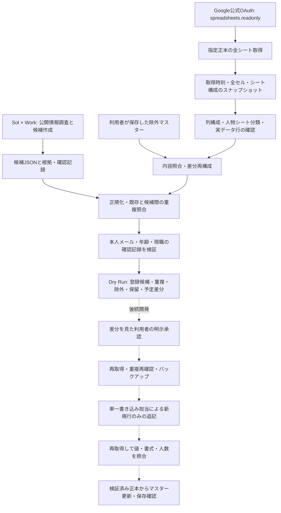

# 医師リスト管理システム 設計

正式仕様は [OPERATIONS_POLICY.md](OPERATIONS_POLICY.md)、今回の開発範囲は [DEVELOPMENT_REQUEST.md](DEVELOPMENT_REQUEST.md) に従う。優先順位は最新の明示指示、正式仕様、開発指示、過去の実装。本文にある過去の人数・行番号は履歴情報であり、現在の登録数・追記位置の算出には使わない。

## 今回の範囲

第1〜4段階を対象にする。Pythonの判定処理、読み取り専用OAuth、全シート取得、JSON候補・除外マスターの読み込み、Dry Runレポートを用意する。第5〜7段階の本番追記・保存後のGoogle再検証・承認操作画面は後続開発とし、この版には書き込みAPIを持たせない。

本番Google Sheetsの読み取り検証は、利用者のOAuth認証が利用可能になってから行う。架空データによる動作確認と、正本による動作確認を混同しない。

## 機能と境界

| 機能 | 第1〜4段階で扱う内容 | 後続段階 |
| --- | --- | --- |
| 正式仕様 | 20項目の原文、開発指示、開発規約を保存 | 変更指示を反映し仕様とテストを再確認 |
| 正本取得 | 指定ID、メインsheetId・名称・列を検査し、全シートを取得 | 追記直前と保存後にも再取得 |
| シート分類 | 人物・非人物・未分類を分離。未分類や未対応列構成は保留 | 分類・統合シートの既存運用を確認して反映 |
| 候補入力 | JSONを検査し、未確認の項目は補完しない | 利用者が画面で根拠や保留を確認 |
| 重複照合 | メール、氏名、旧字体、読み、英字、明示的別名・旧メール、候補間照合 | 保存後にも同じ照合を実行 |
| 条件判定 | 根拠と人による確認を検査。URLだけで真偽を保証しない | 承認は判定結果・取得内容に結び付ける |
| 除外マスター | 正本内容と照合し、既存索引の再利用と再構成、削除履歴保持 | 保存成功後の実データのみで確定更新 |
| レポート | 確認できた登録行数、人数不明の理由、保留理由、予定差分を表示 | 検証済みの保存件数を報告 |
| Googleへの更新 | 実行機能を持たない | 承認・バックアップ・再取得・保存後検証 |
| Windows | Python CLIでDry Run | 日常操作用の承認画面 |

## 正本の取得と集計

唯一の正本はスプレッドシート `1mcimCk9NVrQmaVgDvddiD0kB5PTMDFpnViUr_LMZWVs`。メインは `1997875360` の「都内・公開メール医師」。取得ごとに全シートのID、名称、列、セル内容を確認する。取得に失敗した場合は処理を停止し、古いスナップショットを最新正本として代用しない。

人物シートの登録行は氏名のあるデータ行で数える。途中の空行を行数に混ぜず、最終行は実際に値が存在する位置から求める。グリッドの確保済み行数とは別の値である。氏名がない非空行、未分類シート、想定外の列構成は確認を要求する。「LP・小冊子」等の非人物シートは登録人数に加えない。

実人数は、登録行の人数と同じとは限らない。複数シート間の同一人物、別メール、同姓同名の本人同定が完了していない場合、実人数を `null`（不明）として理由を出す。メールや名前のユニーク件数を実人数と呼ばない。確認されていない人数を推定しない。

## 重複判定と根拠

照合キーは全半角、空白、かな、英字の大小、対応表にある旧字体・新字体を正規化する。ふりがな・ローマ字・旧姓は明示された表記を使い、未知の読みや別名を推測で作らない。旧所属・新所属の違いは別人の証拠にならない。

メール完全一致は登録上の重複衝突として抽出する。本人同定を人が確認した同一識別キーが一致する場合は同一人物として扱う。名前・読み・別表記の一致や文字列の類似だけの場合は「重複疑い」で保留する。同姓同名の別人という解決には、人による本人同定の根拠が必要。共著者のメール等が混ざるため、F・G列の任意のメール文字列を本人のメールとして抽出しない。

本人公開の個人メール、代表・共通メールでないこと、45歳以下の根拠、現在の医師・歯科医師としての所属を個別に検査する。URLの形式や存在だけでは資料内容の正しさを証明できない。誰が、いつ、何を根拠に確認したかを候補に記録し、不足・矛盾は保留する。代表アドレス、推測アドレス、OCRだけで確定したアドレスを採用しない。

年齢推定は確定年齢と分け、基準年・計算根拠・経歴に関する確認を記録する。標準卒業年齢だけを当てはめて自動承認しない。正式仕様の基準年は2026年であり、日付が変わっただけで採用条件の基準年を更新しない。旧所属メールは一律採用・一律除外せず、現在の所属と資料時点を区別し、採否が未解決なら個別確認の保留とする。

## 除外マスター

Libraryのファイルをこの実行環境から直接取得できない場合は、利用者がダウンロードしたJSONをチェックアウト外から読み込む。利用者が共有した構造に基づき、people/source_cells形式の互換読み込みを用意した。元JSON全体を保持し、埋め込まれたコードを実行しない。未知の形式を推測して読み替えず、未対応の構造は停止または保留にする。実データによる確認は利用者のPC上で行う。

マスターは正本ID、取得日時、照合規則のバージョン、全シート内容のハッシュ、記録ごとの行位置とセル内容を持つ。更新日時や件数だけでは同一内容と判断しない。同じ内容の記録は索引を再利用し、行位置変更・追記・修正・削除・別表記変更を反映する。全シートの構成や照合規則が変われば必要な範囲を再構成する。

正本から消えた記録・変更された旧記録は削除履歴として保持し、古いマスターにある人物を未登録として無条件に再採用しない。古いデータとの一致は削除経緯の確認待ちとして保留する。候補を正本の登録済み記録へ先に混ぜない。保存は一時ファイルと置換を使い、保存直後に再読み込みして内容一致を確かめる。

## 予定差分と日付

Dry Runは追記予定のA〜G値を表示するだけである。日付は `Asia/Tokyo` の現在日から和暦形式を生成し、当日の日付が正本にあれば新規行のA列を空欄にする。なければ今回の先頭行だけに記入する。B列は未確認なら空欄。現職・本人メール・年齢の根拠、推定の注記、確認日はF・G列へ追跡できる形で残す。

追記予定位置はメインの実データ最終行の直下から連続させる。予定人数は保存人数ではないため、実際の新規追加人数はDry Runでは0名と報告する。更新後のGoogle状態や保存後検証を実行したと表示しない。

## 第5〜7段階で実装する更新手順

1. 全シートを取得し、登録候補・重複除外・保留・差分を利用者へ表示する。
2. 利用者の明示承認を、候補内容・正本ハッシュ・予定差分・確認日時に結び付ける。
3. 追記直前に全シートを再取得し、変更があれば承認を失効させ再判定する。候補同士の重複も再確認する。
4. 値・書式・入力規則・行高・列幅・シート構成を復旧可能な形で、公開リポジトリ外にバックアップし保存確認する。
5. 単一書き込み担当で、現在の実データ末尾直下の新規範囲だけを更新する。セル値は文字列として扱い、入力による意図しない数式実行を防ぐ。
6. 追加範囲に必要な書式・入力規則を継承し、追加行だけ高さ20pxにする。既存値・書式・列幅・並び・シートタイムゾーンを変更しない。
7. 保存結果を再取得し、予定値、連続した追記位置、既存範囲不変、追加行高、当日日付1回、重複、分類・統合シートとの整合を検証する。
8. 確認済み実データからマスターを更新し、保存を再検証する。
9. 保存を確認できた人数だけを医師・歯科医師別に報告し、正本へのリンクを返す。

Google Sheets APIだけでは外部の編集者を含む厳密な排他・条件付き追記を保証できない。ローカルロックや再取得だけでは、再取得直後の他者編集を防げない。運用上は単一の書き込み担当に限定し、更新中の手動編集を停止する。厳密な排他が必要なら、全書き込みを通す管理サービスを別途設計する。

処理ID、承認内容のハッシュ、予定範囲、保存済み検証状態をローカル台帳に保存する。応答タイムアウト等で保存結果が不明になった場合、無条件に追記を再試行しない。正本を再取得して予定行と内容を照合し、「保存確認済み」「未保存」「一部保存・矛盾」「確認不能」に分ける。一部保存・矛盾・確認不能は安全停止し、バックアップで既存行を自動上書きしない。

第7段階の画面ではファイル選択、全シートの取得状況、重複と保留の根拠、予定差分、明示承認、保存検証の状態を順に示す。秘密情報と実在人物データはリポジトリ外へ保存し、OAuthトークンを画面やログに表示しない。
